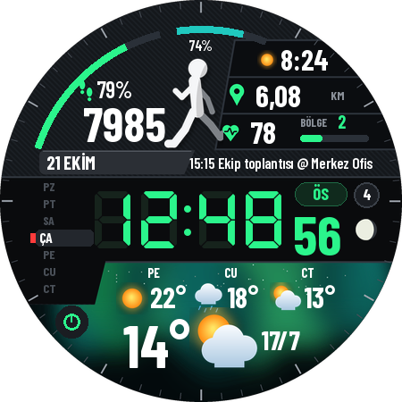

# Mammoth Sport: Wear OS saat kadranı

Watch Face Format (WFF v2) ile yazılmış, sportif ve dijital bir saat kadranı. Uygulama kodu içermez, yalnızca kaynak dosyalarından oluşur.



## Kadranda neler var

- Yeşil 7 segmentli saat (12 veya 24 saat, telefon ayarına göre), saniye ve ÖÖ/ÖS
- Adım sayısı, hedef yüzdesi ve hedef yayı
- Adımdan tahmini mesafe (km)
- Nabız, bölge (BÖLGE 1–5) ve bölge çubuğu
- Saat pili yayı ve yüzdesi
- Ay ve gün, haftanın günü listesi, okunmamış bildirim sayısı, ay evresi
- Hava durumu: anlık sıcaklık, en yüksek/en düşük ve 3 günlük tahmin
- Düzenlenebilir 3 komplikasyon: sağ üst (varsayılan gün doğumu/batımı), sonraki etkinlik, sol alt kısayol
- Ortam (AOD) modunda yalnızca saat gösterilir
- Kadrandaki tüm yazılar Türkçedir (ay ve gün adları, ÖÖ/ÖS, BÖLGE), saatin dil ayarından bağımsız olarak. Komplikasyon metinleri, örneğin etkinlik adı, ilgili uygulamadan geldiği gibi gösterilir.

Gereksinim: **Wear OS 5 veya üzeri** (Galaxy Watch4 ve sonrası, One UI 6 Watch güncellemesiyle).

## APK'yı alma

Her push'ta GitHub Actions APK'yı derler.

Doğrudan indirme linki (her zaman en son sürüm):
https://github.com/keremceylan84-afk/mammoth/releases/download/apk/mammoth-sport.apk

Alternatif olarak:

1. GitHub'da depodaki **Actions** sekmesini açın ve "Build watch face" çalıştırmasını seçin.
2. Sayfanın altındaki **Artifacts** bölümünden `mammoth-watchface-apk` dosyasını indirin.
3. Zip'i açın; içinden `app-release.apk` çıkar.

## Saate yükleme

Önce saatte geliştirici modunu açın:

1. **Ayarlar → Saat hakkında → Yazılım bilgileri** bölümüne gidin ve **Yazılım sürümü**'ne 7 kez dokunun.
2. **Ayarlar → Geliştirici seçenekleri** bölümünde **ADB hata ayıklama** ve **Kablosuz hata ayıklama** seçeneklerini açın.
3. Saat ile telefon (veya bilgisayar) aynı Wi-Fi ağına bağlı olmalı.

### Seçenek A: Bilgisayar olmadan, Android telefondan

1. Telefona **Bugjaeger** veya **Wear Installer 2** uygulamasını kurun (Play Store).
2. Saatte **Kablosuz hata ayıklama → Yeni cihaz eşle** bölümüne girin; ekranda IP:port ve eşleme kodu görünür.
3. Uygulamada bu bilgilerle eşleyin, bağlanın ve `app-release.apk` dosyasını seçip yükleyin.

### Seçenek B: Bilgisayardan ADB ile

```bash
adb pair <saat-ip>:<eşleme-portu>      # saatteki 6 haneli kodu girin
adb connect <saat-ip>:<bağlantı-portu>
adb install app-release.apk
```

Yükledikten sonra saat ekranına uzun basın, kadranlar arasında kaydırın ve **Mammoth Sport**'u seçin. Saatte görünmüyorsa telefondaki Galaxy Wearable uygulamasında **Saat yüzleri → İndirilenler** bölümüne bakın. Komplikasyonları kadrana uzun basıp **Özelleştir** ile değiştirebilirsiniz.

## Geliştirme

Görseller ve `res/raw/watchface.xml` bir betikle üretilir. Kadranı değiştirmek için betiği düzenleyip yeniden çalıştırın:

```bash
pip install pillow
python3 tools/generate_watchface.py
```

Yerelde derlemek için Android SDK gerekir: `./gradlew assembleRelease`.

Fontlar: DSEG7 Classic (keshikan) ve Barlow Condensed (The Barlow Project Authors), ikisi de SIL Open Font License 1.1 ile lisanslı. Lisans metinleri `tools/fonts/` klasöründe.
